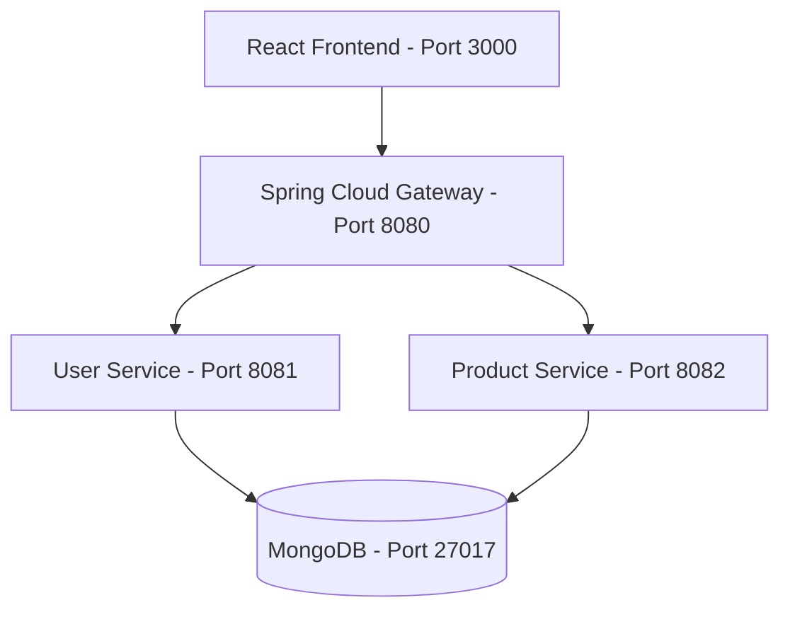

# E-commerce Microservices Application

A premium, containerized E-commerce platform constructed using a Microservices Architecture.

## System Architecture


## Technology Stack
- **Frontend**: React.js (Vite, TypeScript, Vanilla CSS) served by Nginx inside Docker.
- **User Service**: Spring Boot 3.3.x, Java 21, Spring Security (Stateless JWT Auth), Spring Data MongoDB.
- **Product Service**: Spring Boot 3.3.x, Java 21, Spring Data MongoDB.
- **API Gateway**: Spring Cloud Gateway routing endpoints and managing global CORS.
- **Database**: MongoDB (Logical DBs for users and products).
- **CI/CD**: GitHub Actions (CI & GHCR push), Jenkins CD Pipeline.

---

## Getting Started Locally

### Prerequisites
- Docker & Docker Compose
- Java 21 & Maven (optional, if running bare-metal)
- Node.js & npm (optional)

### Deploying the Stack with Docker Compose
To build and spin up the complete platform (database + microservices + gateway + frontend):
```bash
docker compose up --build -d
```

Once started, the services will be mapped as follows:
- **React Frontend**: [http://localhost:3000](http://localhost:3000)
- **API Gateway (Central Access Point)**: [http://localhost:8080](http://localhost:8080)
- **User Service (Internal)**: [http://localhost:8081](http://localhost:8081)
- **Product Service (Internal)**: [http://localhost:8082](http://localhost:8082)
- **MongoDB**: `localhost:27017`

### Default Admin Registration
To test the product CRUD operations in the Admin Portal, select **"Register as Administrator"** on the registration page to assign the `ROLE_ADMIN` authority to your account.
