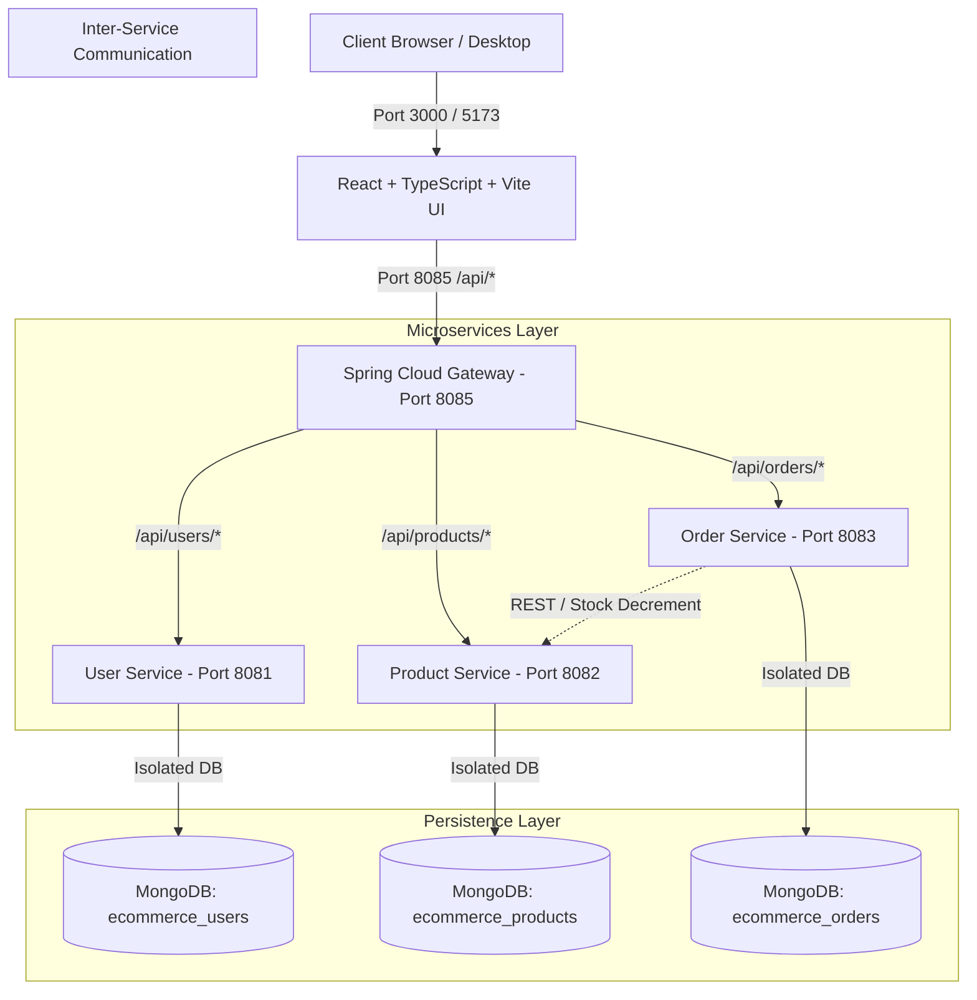

# Cartify - Full-Stack Microservices E-Commerce Platform

[](https://www.oracle.com/java/)
[](https://spring.io/projects/spring-boot)
[](https://spring.io/projects/spring-cloud-gateway)
[-blue.svg?style=flat&logo=react)](https://react.dev/)
[](https://www.mongodb.com/)
[](https://www.docker.com/)
[](https://github.com/features/actions)

> **Cartify** is a production-ready, distributed cloud-native e-commerce platform built on a decoupled microservices architecture with Spring Boot 3, separated MongoDB databases, a Spring Cloud Gateway reverse proxy, and a modern React frontend.

---

## 📌 Resume Highlights & Core Pillars

- **Microservices Architecture**: Built a distributed e-commerce platform using **React**, **Spring Boot 3**, and **separated MongoDB databases** (`ecommerce_users`, `ecommerce_products`, `ecommerce_orders`) to enforce domain isolation.
- **API Gateway & Security**: Engineered a centralized **Spring Cloud Gateway** for reverse-proxy routing, CORS management, Netty connection pooling, and stateless **JWT Role-Based Access Control (RBAC)** across `ROLE_CUSTOMER` and `ROLE_ADMIN`.
- **CI/CD Automation**: Automated CI/CD pipelines via **GitHub Actions** and **Jenkins** to validate multi-module Maven builds and publish container images directly to **GitHub Container Registry (GHCR)**.
- **Containerization & Orchestration**: Containerized all services using **multi-stage Docker builds** (Alpine JRE & Nginx) and orchestrated local and staging environments with **Docker Compose** and **Kubernetes** manifests.

---

## 🏛️ System Architecture



---

## 🚀 Key Features

### 🛍️ Customer Experience
- **Interactive Product Catalog**: Instant search, category filters (Electronics, Fashion, Home, Sports, Beauty), price sorting, and rating filters.
- **Rich Media & Reliability**: High-resolution product images with automatic fallback to placeholder fallbacks.
- **Cart & Dynamic Pricing**: Real-time quantity adjustment, stock limit detection, free shipping progress bar, and coupon code calculation.
- **Seamless Checkout & Address Management**: Multi-step checkout with saved shipping addresses, order review, and dummy payment gateway integration.
- **Order Tracking & After-Sales**: Comprehensive order history with real-time status badges, itemized tracking, return requests, and replacement workflows.

### 🛡️ Admin & Store Operations
- **Product Management Dashboard**: Paginated product catalog table with live keyword filtering, stock status indicators, and modal CRUD operations.
- **Inventory Control**: Live stock increment/decrement, price adjustments, and catalog updates.
- **Role-Based Access Control (RBAC)**: Enforced via stateless JWT tokens with role verification on the API Gateway and service layers.

### ⚡ Performance & Frontend Architecture
- **Route-level Code Splitting**: Utilizing `React.lazy()` and `Suspense` for minimal bundle sizes and fast First Contentful Paint (FCP).
- **In-Memory Client API Cache**: 60-second TTL cache for GET requests with automatic cache invalidation on write/mutation requests.
- **Responsive & Accessible UI**: Hand-crafted CSS design system with glassmorphism, fluid animations, and mobile-friendly drawer navigation.

---

## 🛠️ Technology Stack

| Domain | Technologies |
|---|---|
| **Frontend** | React 19, TypeScript, Vite, Vanilla CSS Design System, Axios, Lucide React Icons |
| **Backend Services** | Java 21, Spring Boot 3.3.x, Spring Web, Spring Security, Spring Data MongoDB, Lombok |
| **API Gateway** | Spring Cloud Gateway, Reactive Netty Server, Global CORS Configuration |
| **Database** | MongoDB 7.0 (Separated databases per microservice domain) |
| **DevOps & Containers** | Docker (Multi-stage builds), Docker Compose, Kubernetes (K8s Deployments & Services) |
| **CI/CD** | GitHub Actions (`ci.yml`, `docker-publish.yml`), Jenkinsfile |

---

## 🔌 Service Port Registry

| Service | Port | Description | Database |
|---|---|---|---|
| **Frontend** | `3000` (Prod) / `5173` (Dev) | React Web Application (Nginx / Vite) | - |
| **API Gateway** | `8085` | Central Gateway & Reverse Proxy | - |
| **User Service** | `8081` | Authentication, JWT, Profiles & Addresses | `ecommerce_users` |
| **Product Service** | `8082` | Product Catalog, Categories, Stock Management | `ecommerce_products` |
| **Order Service** | `8083` | Order Lifecycle, Returns & Exchanges | `ecommerce_orders` |
| **MongoDB** | `27017` | Multi-Database Mongo Instance | `ecommerce` |

---

## 🏁 Quick Start & Local Deployment

### 1. Prerequisites
- [Docker Desktop](https://www.docker.com/products/docker-desktop/) (v24+ recommended)
- [Java 21 JDK](https://www.oracle.com/java/) & [Maven](https://maven.apache.org/) (optional for local bare-metal execution)
- [Node.js 20+](https://nodejs.org/) & [npm](https://www.npmjs.com/) (optional for local frontend dev)

### 2. Run Complete Stack with Docker Compose
To build all microservices, package container images, and start the system:

```bash
# Clone the repository
git clone https://github.com/Ankit8810770036/Full-Stack-E-Commerce-Platform.git
cd Full-Stack-E-Commerce-Platform

# Build and start all 6 containers in detached mode
docker compose up --build -d
```

### 3. Verify Containers
```bash
docker compose ps
```
All containers (`mongodb`, `user-service`, `product-service`, `order-service`, `api-gateway`, `frontend`) should report healthy/running.

### 4. Access Applications
- **Storefront & Admin UI**: [http://localhost:3000](http://localhost:3000)
- **API Gateway**: [http://localhost:8085](http://localhost:8085)
- **Product Service API**: [http://localhost:8085/api/products](http://localhost:8085/api/products)

---

## 🔑 Default Accounts & Role Testing

| Role | Email | Password | Access Capabilities |
|---|---|---|---|
| **Admin User** | `admin@cartify.com` | `admin123` | Full Storefront + Admin Product Management (`/admin/products`) |
| **Customer User** | `user@cartify.com` | `user123` | Storefront browsing, Cart, Checkout, Order Tracking |

*Note: You can also register a new account on the UI and check "Register as Administrator" to create additional admin users.*

---

## 📦 Database Seeding (Optional)

To seed initial curated products into the catalog:
```powershell
# In PowerShell:
.\seed_products.ps1
```

---

## 🔄 CI/CD & Deployment Workflows

- **`.github/workflows/ci.yml`**: Runs on every pull request to compile all Spring Boot microservices with Maven, execute unit tests, and build the React TypeScript frontend.
- **`.github/workflows/docker-publish.yml`**: Triggers on release/push to `main` to build multi-stage Docker images and push them to **GitHub Container Registry (GHCR)**.
- **`Jenkinsfile`**: Declarative multi-branch pipeline supporting linting, testing, Docker image building, and deployment orchestration.
- **`k8s/`**: Kubernetes configuration manifests for cloud deployment (Minikube / EKS / GKE).

---

## 📜 License
This project is open-source and available under the [MIT License](LICENSE).
